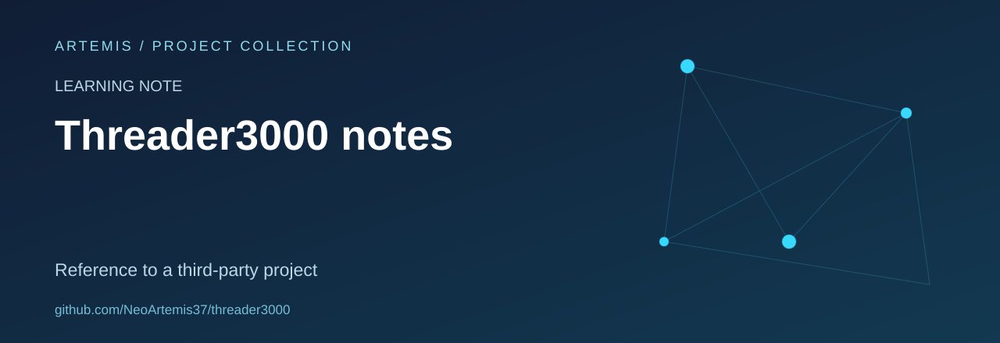

# Threader3000 learning note

A reference note about a third-party network-security tool.

## Scope and status

This repository contains a README only. It does not contain an original implementation or publish the third-party package. The software referenced by its historical notes belongs to its upstream maintainers.

## Repository contents

README.md. Existing material and repository history are retained; this README is a presentation and provenance update.

## Review priorities

- Document the exact provenance and the limits of historical claims.
- Separate reproducible observations from assumptions.
- Prefer defensive analysis, local fixtures and clear remediation notes.

## Attribution and licensing

No new license or authorship claim is introduced by this documentation update. Verify the provenance and applicable permissions before reuse.

## About this collection

Maintained as part of [Artemis’s project and learning collection](https://github.com/NeoArtemis37).
